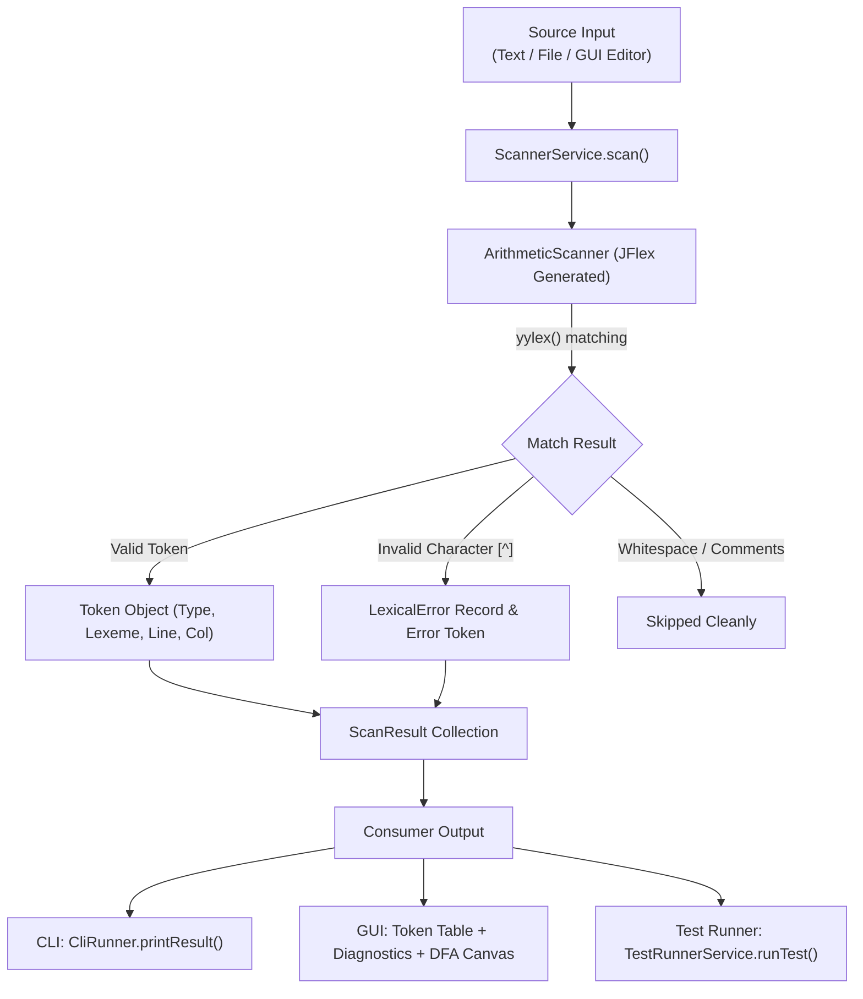

# Detailed Project Architecture & Function-by-Function Explanation

**Project:** Arithmetic Input Scanner (Topic 4)  
**Course:** Compilation I4 GIC — Academic Year 2026–2027  
**Lecturer:** OL Phearun  
**Implementation:** JFlex Lexer Generator, Java 17, JavaFX Interactive GUI, Maven Build System  

---

## 📑 Table of Contents
1. [Project Overview & Architecture](#1-project-overview--architecture)
2. [Project File Map & Directory Tree](#2-project-file-map--directory-tree)
3. [End-to-End Data Flow](#3-end-to-end-data-flow)
4. [Build Configuration: `pom.xml`](#4-build-configuration-pomxml)
5. [Lexical Specification: `ArithmeticScanner.flex`](#5-lexical-specification-arithmeticscannerflex)
6. [Entry Point: `Main.java`](#6-entry-point-mainjava)
7. [CLI Driver: `CliRunner.java`](#7-cli-driver-clirunnerjava)
8. [Data Models (`com.compiler.model`)](#8-data-models-comcompilermodel)
   - [8.1 `TokenType.java`](#81-tokentypejava)
   - [8.2 `Token.java`](#82-tokenjava)
   - [8.3 `LexicalError.java`](#83-lexicalerrorjava)
   - [8.4 `ScanResult.java`](#84-scanresultjava)
   - [8.5 `TestCase.java`](#85-testcasejava)
   - [8.6 `TestReport.java`](#86-testreportjava)
9. [Service Layer (`com.compiler.service`)](#9-service-layer-comcompilerservice)
   - [9.1 `ScannerService.java`](#91-scannerservicejava)
   - [9.2 `TestRunnerService.java`](#92-testrunnerservicejava)
10. [Graphical User Interface Modular Architecture](#10-graphical-user-interface-modular-architecture)
    - [10.1 UI Components (`com.compiler.gui.ui`)](#101-ui-components-comcompilerguiui)
    - [10.2 Layout Components (`com.compiler.gui.layouts`)](#102-layout-components-comcompilerguilayouts)
    - [10.3 Views (`com.compiler.gui.views`)](#103-views-comcompilerguiviews)
    - [10.4 `DfaCanvas.java`](#104-dfacanvasjava)
    - [10.5 `ScannerGuiApp.java`](#105-scannerguiappjava)
11. [Resources & Automated Test Cases](#11-resources--automated-test-cases)
12. [Competing Rules Disambiguation & DFA Logic](#12-competing-rules-disambiguation--dfa-logic)

---

## 1. Project Overview & Architecture

The **Arithmetic Input Scanner** is a complete, modular lexical analyzer designed to tokenize arithmetic and relational expressions according to formal compiler theory. It uses **JFlex** to generate a high-performance Deterministic Finite Automaton (DFA) scanner in Java.

The project is structured into three clean layers:
1. **Core Lexer Layer:** `ArithmeticScanner.flex` defines regular expressions and token generation rules. JFlex compiles this into `ArithmeticScanner.java`.
2. **Service & Model Layer:** Encapsulates tokens, errors, test reports, and scanning services so both CLI and GUI use identical logic.
3. **Presentation Layer:**
   - **CLI (`CliRunner`):** Formats output into a standard 4-column token table (`Token type | Lexeme | Line | Column`) and reports errors.
   - **GUI (`ScannerGuiApp` + `DfaCanvas`):** A modern JavaFX desktop suite featuring live real-time scanning, syntax error diagnostics with direct code highlighting, an automated 16-test runner, and an interactive DFA state machine tracer.

---

## 2. Project File Map & Directory Tree

```
ArithmeticInputScanner/
├── pom.xml                                   # Maven build configuration & dependencies
├── Explaination.md                           # Comprehensive documentation of all files and functions
├── README.md                                 # High-level overview, quickstart, and requirements
├── REPORT.md                                 # Formal Lab 01 report for submission
├── SLIDES.md / presentation_slides.html      # 10-minute presentation slides
├── src/
│   ├── main/
│   │   ├── jflex/
│   │   │   └── ArithmeticScanner.flex        # JFlex lexical rules and macro definitions
│   │   ├── java/com/compiler/
│   │   │   ├── Main.java                     # Universal entry point (detects GUI vs CLI vs Test)
│   │   │   ├── cli/
│   │   │   │   └── CliRunner.java            # Command-line runner and token table printer
│   │   │   ├── model/
│   │   │   │   ├── TokenType.java            # Enum for 20 token types + ERROR with category colors
│   │   │   │   ├── Token.java                # Immutable token object (type, lexeme, line, col)
│   │   │   │   ├── LexicalError.java         # Record representing invalid characters and positions
│   │   │   │   ├── ScanResult.java           # Container for tokens, errors, and timing metrics
│   │   │   │   ├── TestCase.java             # Record representing automated test case metadata
│   │   │   │   └── TestReport.java           # Record holding test verification outcomes
│   │   │   ├── service/
│   │   │   │   ├── ScannerService.java       # High-level scanning API (Strings and Files)
│   │   │   │   └── TestRunnerService.java    # Harness executing the 16 benchmark test cases
│   │   │   └── gui/
│   │   │       ├── DfaCanvas.java            # Custom JavaFX Canvas drawing interactive DFA
│   │   │       ├── ScannerGuiApp.java        # Main JavaFX application orchestrator
│   │   │       ├── layouts/
│   │   │       │   ├── TopNavBar.java        # Navigation bar with nav pills, presets, & Open File
│   │   │       │   └── MainLayout.java       # BorderPane organizing top navbar and central view stack
│   │   │       ├── ui/
│   │   │       │   ├── AlertHelper.java      # Modal dialog utility
│   │   │       │   ├── RuleCard.java         # Card explaining competing rule disambiguation
│   │   │       │   ├── TokenTable.java       # TableView with category badges & real-time search filter
│   │   │       │   └── ErrorAlertBox.java    # Lexical error alert list with "Jump to Error" navigation
│   │   │       └── views/
│   │   │           ├── MainScanner.java      # View 1: Code editor, token stream table, and error list
│   │   │           ├── AutomatedTest.java    # View 2: 16-test benchmark runner with pass/fail badges
│   │   │           └── DFA.java              # View 3: DFA state machine tracer and competing rules
│   │   └── resources/
│   │       └── styles/
│   │           ├── app.css                   # Modern clean dashboard stylesheet
│   │           └── dark.css                  # Optional dark theme stylesheet
│   └── test/resources/
│       ├── test_input.txt                    # Integration sample input
│       ├── tests/ (N01.txt - BUG01.txt)      # 16 individual test case inputs
│       └── expected/ (*_expected.txt)        # 16 expected token outputs
```

---

## 3. End-to-End Data Flow



---

## 4. Build Configuration: `pom.xml`

### Purpose:
The `pom.xml` file configures the Maven build lifecycle, compiler versions, external libraries, and compilation plugins.

### Key Components & Plugins:
- **`properties`:**
  - `maven.compiler.release = 17`: Configures modern Java 17 features (records, switch expressions, text blocks).
  - `jflex.version = 1.9.1`: Uses the official JFlex scanner generator.
  - `javafx.version = 21.0.2`: OpenJFX UI controls and graphics.
- **`dependencies`:**
  - `javafx-controls`, `javafx-fxml`, `javafx-graphics`, `javafx-base`: Required for the graphical dashboard.
- **`plugins`:**
  - `de.jflex:jflex-maven-plugin`: Automatically generates `ArithmeticScanner.java` in `target/generated-sources/jflex/` from `ArithmeticScanner.flex` during the `generate-sources` phase before Java compilation.
  - `org.apache.maven.plugins:maven-compiler-plugin`: Compiles Java 17 sources with UTF-8 encoding.
  - `org.openjfx:javafx-maven-plugin`: Enables running the JavaFX interface directly with `mvn javafx:run`.
  - `org.codehaus.mojo:exec-maven-plugin`: Enables running CLI commands and test suites directly via `mvn exec:java`.
  - `org.apache.maven.plugins:maven-assembly-plugin`: Packages a self-contained executable JAR (`jar-with-dependencies`) for submission and distribution.

---

## 5. Lexical Specification: `src/main/jflex/ArithmeticScanner.flex`

### Purpose:
The core specification file parsed by JFlex to generate the lexical analyzer class `com.compiler.ArithmeticScanner`.

### 5.1 JFlex Directives:
- `%class ArithmeticScanner`: Names the generated Java class `ArithmeticScanner`.
- `%public`: Makes the class public so services outside the package can access it.
- `%unicode`: Enables full Unicode character support.
- `%line`: Directs JFlex to maintain line numbers in internal variable `yyline` (0-based).
- `%column`: Directs JFlex to maintain column numbers in internal variable `yycolumn` (0-based).
- `%type Token`: Specifies that the scanning method `yylex()` returns objects of type `com.compiler.model.Token` (returning `null` at EOF).

### 5.2 Embedded Java Code & Methods:
Located in the `%{ ... %}` block:

| Function / Member | Return Type | Description |
| :--- | :--- | :--- |
| `errors` | `List<LexicalError>` | Internal collection storing all lexical errors encountered during scanning. |
| `getErrors()` | `List<LexicalError>` | Getter returning the list of recorded lexical errors. |
| `resetErrors()` | `void` | Clears the error list before initiating a new scan pass. |
| `token(TokenType type)` | `Token` | Helper method that constructs a `Token` using the matched lexeme (`yytext()`), adjusting 0-based positions to 1-based indexing (`yyline + 1`, `yycolumn + 1`). |
| `errorToken()` | `Token` | Called when an unrecognized character matches `[^]`. Constructs a `LexicalError`, appends it to `errors`, and returns a `Token` of type `TokenType.ERROR`. This ensures scanning continues to EOF without crashing. |
| `scanAll()` | `List<Token>` | Utility method that repeatedly invokes `yylex()` until EOF (`null`), returning all accumulated tokens as a list. |

### 5.3 Macro Definitions:
- `LineTerminator`: `\r|\n|\r\n` (handles Windows, Unix, and Mac line breaks).
- `Whitespace`: `{LineTerminator} | [ \t\f]` (skips blank spaces and line changes).
- `InputCharacter`: `[^\r\n]` (any character except newlines).
- `SingleLineComment`: `"//" {InputCharacter}*` (C/Java style single-line comments).
- `TraditionalComment`: `"/*" [^*] ~"*/" | "/*" "*"+ "/"` (multi-line block comments using JFlex up-to operator `~`).
- `Comment`: `{SingleLineComment} | {TraditionalComment}`.
- `Letter`: `[a-zA-Z_]` (letters and underscores for identifiers).
- `Digit`: `[0-9]` (base-10 digits).
- `Identifier`: `{Letter} ({Letter} | {Digit})*` (valid variable/function names).
- `Integer`: `0 | [1-9]{Digit}*` (non-negative integer; disallows invalid leading zeros like `05`).
- `Decimal`: `{Integer} \. {Digit}+` (floating numbers requiring digits before and after the period).

### 5.4 Rules and Priority Ordering:
1. **Whitespace & Comments:** `{Whitespace}` and `{Comment}` have empty action `{}` to discard them silently while advancing position counters.
2. **Relational Operators:** Multi-character operators (`>=`, `<=`, `==`, `!=`) are declared before single-character operators (`>`, `<`).
3. **Arithmetic & Assignment:** `=`, `+`, `-`, `*`, `/`, `%`, `^`.
4. **Delimiters:** `(`, `)`, `;`, `,`.
5. **Literals & Identifiers:** `{Decimal}`, `{Integer}`, `{Identifier}`.
6. **Error Catch-All:** `[^]` matches any character not matched by preceding rules, invoking `errorToken()`.

---

## 6. Entry Point: `src/main/java/com/compiler/Main.java`

### Purpose:
The universal launcher for the application. It inspects command-line arguments and system environment to determine whether to run the CLI, the automated test suite, or the JavaFX GUI.

### Functions & Methods:

| Function / Method | Signature | Description |
| :--- | :--- | :--- |
| `main` | `public static void main(String[] args)` | Evaluates `args`: flags `--test`/`-t` run CLI test suite; `--help`/`-h` print help; `--gui`/`-g` launch GUI; a file path runs `CliRunner`; if no args, launches GUI (or shows help if in a headless environment). |
| `launchGui` | `private static void launchGui(String[] args)` | Calls `ScannerGuiApp.launchApp(args)` inside a `try-catch` block. If JavaFX graphics fail to initialize (e.g. headless server), it gracefully falls back to CLI mode. |
| `runAutomatedTestsCli` | `private static void runAutomatedTestsCli()` | Executes all 16 test cases via `TestRunnerService`, prints a formatted console table with ANSI colors (`PASS` in green, `FAIL` in red), and reports the overall success percentage. |
| `printHelp` | `private static void printHelp()` | Prints usage commands, syntax guidelines, and Maven lifecycle shortcuts to standard output. |

---

## 7. CLI Driver: `src/main/java/com/compiler/cli/CliRunner.java`

### Purpose:
Drives command-line file scanning and formats tokens and errors to match the project brief requirements.

### Functions & Methods:

| Function / Method | Signature | Description |
| :--- | :--- | :--- |
| `run` | `public int run(String[] args)` | Validates the target file's existence, calls `scannerService.scanFile()`, outputs results via `printResult()`, and returns exit codes: `0` (clean scan), `1` (I/O error / invalid arguments), or `2` (lexical errors present). |
| `printResult` | `public void printResult(ScanResult result)` | Formats tokens into a clean 4-column table: `Token type | Lexeme | Line | Column`. Prints all lexical errors to `System.err`, and displays total tokens, error count, and elapsed time in milliseconds. |
| `escapeLexeme` | `private String escapeLexeme(String lexeme)` | Escapes whitespace characters (`\n` to `\n`, `\t` to `\t`) so table columns remain visually aligned. |
| `printUsage` | `private void printUsage()` | Prints syntax instructions for running the CLI. |

---

## 8. Data Models (`src/main/java/com/compiler/model/`)

### 8.1 `TokenType.java`
An `enum` defining the **20 valid token types** recognized by the scanner, plus a special `ERROR` type.
- **Identifier:** `IDENTIFIER`
- **Literals:** `INTEGER`, `DECIMAL`
- **Assignment:** `ASSIGN` (`=`)
- **Arithmetic Operators:** `OP_PLUS` (`+`), `OP_MINUS` (`-`), `OP_MUL` (`*`), `OP_DIV` (`/`), `OP_MOD` (`%`), `OP_POW` (`^`)
- **Relational Operators:** `OP_GT` (`>`), `OP_GTE` (`>=`), `OP_LT` (`<`), `OP_LTE` (`<=`), `OP_EQ` (`==`), `OP_NEQ` (`!=`)
- **Delimiters:** `LPAREN` (`(`), `RPAREN` (`)`), `SEMICOLON` (`;`), `COMMA` (`,`)
- **Error:** `ERROR`

#### Inner Enum: `Category`
Groups token types for GUI badge coloring and filtering:
- `IDENTIFIER` (Blue `#3b82f6`)
- `LITERAL` (Green `#10b981`)
- `OPERATOR` (Amber `#f59e0b`)
- `COMPARISON` (Purple `#8b5cf6`)
- `DELIMITER` (Slate `#64748b`)
- `ERROR` (Red `#ef4444`)

#### Methods:
- `getTypeName()`: Returns the string token name (e.g. `"OP_PLUS"`).
- `getDescription()`: Returns a human-readable description (e.g. `"Addition Operator (+)"`).
- `getCategory()`: Returns the token's category enum.
- `toString()`: Returns `typeName`.

---

### 8.2 `Token.java`
An immutable class representing an individual recognized token.

#### Fields:
- `type`: `TokenType`
- `lexeme`: `String` (matched characters in source text)
- `line`: `int` (1-based line position)
- `column`: `int` (1-based column position)
- `detail`: `String` (optional supplementary information)

#### Methods:
- `Token(...)`: Constructors (4-argument and 5-argument).
- `getType()`, `getTypeName()`, `getLexeme()`, `getLine()`, `getColumn()`, `getDetail()`: Standard accessors.
- `getCategory()`: Returns the category label string.
- `getCategoryColor()`: Returns the hex color string for UI pills.
- `isError()`: Returns `true` if `type == TokenType.ERROR`.
- `toString()`: Formats token for logging: `TYPE | lexeme | line | col`.

---

### 8.3 `LexicalError.java`
A Java `record` representing a lexical anomaly detected during scanning.

#### Record Components:
- `invalidLexeme`: The unexpected character sequence (e.g. `"$"`).
- `line`: 1-based line number.
- `column`: 1-based column number.
- `message`: Diagnostic error message (e.g. `"Unexpected character '$'"`).

#### Methods:
- `toString()`: Generates human-readable error description with line and column.

---

### 8.4 `ScanResult.java`
An immutable aggregate container storing the complete outcome of a lexical analysis pass.

#### Fields:
- `tokens`: `List<Token>` (unmodifiable list of all tokens).
- `errors`: `List<LexicalError>` (unmodifiable list of detected errors).
- `executionTimeNs`: `long` (elapsed scan time in nanoseconds).
- `totalLines`: `int` (number of lines processed).
- `totalCharacters`: `int` (total characters analyzed).

#### Methods:
- `getTokens()`, `getErrors()`, `getTotalLines()`, `getTotalCharacters()`: Standard getters.
- `hasErrors()`: Returns `true` if `errors` is not empty.
- `getTokenCount()`: Total count of tokens.
- `getErrorCount()`: Total count of errors.
- `getExecutionTimeNs()` / `getExecutionTimeMs()`: Elapsed time in nanoseconds or milliseconds.

---

### 8.5 `TestCase.java`
A Java `record` defining the metadata and inputs for an automated test case.

#### Record Components:
- `id`: Unique identifier (e.g. `"N01"`, `"B02"`, `"E01"`, `"BUG01"`).
- `category`: Category string (`"Normal"`, `"Boundary"`, `"Invalid"`, `"Bug Correction"`).
- `title`: Short descriptive name.
- `description`: Explains what scenario is being verified.
- `input`: The raw arithmetic expression string.
- `expectedSummary`: Human-readable summary of expected token output.

---

### 8.6 `TestReport.java`
A Java `record` capturing the execution result and verification of a `TestCase`.

#### Record Components:
- `testCase`: The `TestCase` that was executed.
- `passed`: `boolean` flag (`true` if scanner output satisfies test assertions).
- `scanResult`: The raw `ScanResult` generated by the scanner.
- `message`: Diagnostic message explaining why the test passed or failed.

---

## 9. Service Layer (`src/main/java/com/compiler/service/`)

### 9.1 `ScannerService.java`
Provides a decoupled, reusable service interface for scanning source text from strings or files.

#### Functions & Methods:

| Function / Method | Signature | Description |
| :--- | :--- | :--- |
| `scan` | `public ScanResult scan(String sourceText)` | Creates a `StringReader` from `sourceText`, initializes `ArithmeticScanner`, measures scan duration via `System.nanoTime()`, collects all tokens via `scanAll()`, retrieves recorded lexical errors, and returns a comprehensive `ScanResult`. |
| `scanFile` | `public ScanResult scanFile(File file) throws IOException` | Reads the file using UTF-8 encoding via `BufferedReader`, reconstructs line content, and delegates to `scan(String)`. |

---

### 9.2 `TestRunnerService.java`
The automated test harness managing the **16 benchmark test cases** required by the project brief.

#### Functions & Methods:

| Function / Method | Signature | Description |
| :--- | :--- | :--- |
| `TestRunnerService` | `public TestRunnerService()` | Constructor that calls `initTestCases()`. |
| `initTestCases` | `private void initTestCases()` | Initializes 16 test cases:<br/>• **6 Normal Cases (`N01`–`N06`):** assignments, parentheses, power/modulo, relational comparisons, multi-statements, and comments.<br/>• **5 Boundary Cases (`B01`–`B05`):** empty input, adjacent competing operators (`>=`, `==`), decimal vs integer distinction, division operator `/` vs comment `//`, EOF boundary.<br/>• **4 Invalid Cases (`E01`–`E04`):** illegal `$`, multiple illegal characters `#` and `@`, malformed double-dot decimals `3.14.15`, unsupported tilde `~` and quotes `"`.<br/>• **1 Bug Correction Case (`BUG01`):** verifies that incomplete decimals like `12.` are not matched as broken decimals, but tokenized as integer `12` followed by an error for `.`. |
| `getAllTestCases` | `public List<TestCase> getAllTestCases()` | Returns an unmodifiable list of all test cases. |
| `runTest` | `public TestReport runTest(TestCase tc)` | Runs `scannerService.scan(tc.input())` and executes specific assertions for that test ID (verifying exact token counts, specific token types, error count, and error lexemes). Returns a `TestReport`. |
| `runAllTests` | `public List<TestReport> runAllTests()` | Iterates through all 16 test cases, executes each, and returns a list of `TestReport` instances. |

---

## 10. Graphical User Interface Modular Architecture

The graphical presentation layer is decoupled into focused, modular packages:
- `com.compiler.gui.ui`: Reusable custom UI components and dialog helpers.
- `com.compiler.gui.layouts`: Top-level navigation and composite layout frames.
- `com.compiler.gui.views`: Screen-level view components (Scanner, Test Suite, DFA).
- `com.compiler.gui`: Application lifecycle orchestrator and DFA custom canvas.

---

### 10.1 UI Components (`src/main/java/com/compiler/gui/ui/`)

#### 1. `AlertHelper.java`
Modal dialog utility providing standardized popup alerts.
- `public static void showAlert(Window owner, String title, String message)`: Displays a JavaFX information alert attached to the parent window.

#### 2. `RuleCard.java`
A custom `VBox` card component styled for presenting regular expression disambiguation rules in the DFA tab.
- `public RuleCard(String title, String body)`: Initializes card with bold title header and formatted body text.

#### 3. `TokenTable.java`
A specialized `TableView<Token>` displaying recognized lexical tokens.
- Columns configured: `TOKEN TYPE` (color-coded badge), `LEXEME` (monospace), `LINE : COL`, and `CATEGORY`.
- `public void setTokens(List<Token> tokens)`: Updates the table's master dataset.
- `public void filter(String query)`: Filters rows in real-time across token type, lexeme, or category.
- `public ObservableList<Token> getMasterData()`: Returns backing observable list.

#### 4. `ErrorAlertBox.java`
A `VBox` error notification container displaying interactive error alert cards.
- `public void setOnJumpToError(BiConsumer<Integer, Integer> jumpHandler)`: Binds callback to jump to an error in the source editor.
- `public void updateErrors(List<LexicalError> errors)`: Rebuilds red alert cards displaying invalid character, line, column, and a "Jump to Error" button. Hides automatically when error list is empty.

---

### 10.2 Layout Components (`src/main/java/com/compiler/gui/layouts/`)

#### 1. `TopNavBar.java`
Top navigation bar component managing top-level switching and actions.
- Inner Enum: `NavTab` (`SCANNER`, `TESTS`, `DFA`).
- `public TopNavBar(List<TestCase> presetTestCases)`: Initializes navigation buttons, preset examples combo box, and "Open File" button.
- `public void selectTab(NavTab tab)`: Updates active button styling and triggers navigation listener.
- `public void setActiveTabButton(NavTab tab)`: Styles active tab pill with `.nav-pill-active`.
- `public void setOnTabSelected(Consumer<NavTab> handler)`: Callback when tab changes.
- `public void setOnPresetSelected(Consumer<TestCase> handler)`: Callback when a preset example is chosen.
- `public void setOnOpenFileRequested(Runnable handler)`: Callback when "Open File" is clicked.

#### 2. `MainLayout.java`
A custom `BorderPane` organizing the application window.
- `public MainLayout(TopNavBar topNavBar, Node... views)`: Embeds `topNavBar` at top and manages central `StackPane contentStack` with padding.
- `public void showView(Node viewToShow)`: Toggles visibility so only the selected view is visible and managed.
- `public TopNavBar getTopNavBar()` / `public StackPane getContentStack()`: Accessor methods.

---

### 10.3 Views (`src/main/java/com/compiler/gui/views/`)

#### 1. `MainScanner.java`
The primary split-pane scanner view combining the code editor and recognized tokens table.
- **Left Card:** Source code `TextArea`, "Clear" button, "Scan Expression" button, and auto-scanning text listener.
- **Right Card:** Recognized tokens header, search filter `TextField`, `TokenTable`, and `ErrorAlertBox`.
- `public void performScan()`: Scans editor text via `ScannerService`, updates `TokenTable`, refreshes `ErrorAlertBox`, and notifies scan completion listener.
- `public void setCode(String code)` / `public String getCode()`: Gets or sets editor content.
- `public void highlightPosition(int targetLine, int targetCol)`: Calculates character offset and highlights invalid character in `codeEditor`.
- `public void setOnScanCompleted(Consumer<ScanResult> listener)`: Callback for external metric listeners.

#### 2. `AutomatedTest.java`
View running and displaying the 16 benchmark test cases.
- Header with summary status badge and "▶ Run All Tests" button.
- `TableView<TestReport>` displaying test ID, category, name, pass/fail status pill, and verification notes.
- Double-clicking any row invokes `onTestCaseSelected` to load that test case directly into the scanner.
- `public void runAllAutomatedTests()`: Runs all 16 tests via `TestRunnerService` and updates table and summary badge.
- `public void setOnTestCaseSelected(Consumer<TestCase> callback)`: Binds row double-click selection callback.
- `public boolean hasReports()`: Indicates whether tests have already run.

#### 3. `DFA.java`
View presenting the DFA state machine for decimal numbers and competing rule cards.
- Title header, subtitle, and "Trace Number" `TextField`.
- Embeds `DfaCanvas` to draw interactive state transitions.
- Grid with three `RuleCard` instances explaining:
  1. Relational `>=` vs `>` (Longest match chooses `>=`).
  2. Decimal `12.5` vs `12` (Longest match chooses `12.5`).
  3. Comment `//` vs Division `/` (Longest match matches comment to end of line).
- `public void setSimulatedInput(String input)`: Forwards test input to tracer field and canvas.
- `public DfaCanvas getDfaCanvas()`: Canvas accessor.

---

### 10.4 `DfaCanvas.java`
A custom JavaFX `Canvas` component that visually draws the Deterministic Finite Automaton (DFA) state machine for Decimal numbers:
$$\text{DECIMAL} = (0 \mid [1-9][0-9]*)\.[0-9]+$$

#### States Rendered:
- **`S0`:** Start state.
- **`S1`:** Read leading `0`.
- **`S2`:** Read non-zero digit `1-9`, loops on digits `0-9`.
- **`S3`:** Read decimal point `.`.
- **`S4`:** Read fractional digit `0-9` (Accepting State with double-ring).

#### Functions & Methods:

| Function / Method | Signature | Description |
| :--- | :--- | :--- |
| `DfaCanvas` | `public DfaCanvas(double w, double h)` | Constructor initializing canvas dimensions and triggering the initial draw. |
| `setDarkMode` / `isDarkMode` | `public void setDarkMode(boolean)` / `public boolean isDarkMode()` | Sets and queries dark mode color palette. |
| `setSimulatedInput` | `public void setSimulatedInput(String input)` | Updates simulated input string, calls `computeActiveStates()`, and re-renders the canvas. |
| `computeActiveStates` | `private void computeActiveStates()` | Simulates the DFA step-by-step against `simulatedInput`. Feeds each character through the transition table and stores the visited state sequence in `activeStates`. |
| `draw` | `public final void draw()` | Clears canvas, renders states `S0`–`S4`, draws transition arrows and self-loops with character labels, highlights active/current states with distinctive colors, and renders legend text. |
| `drawState` | `private void drawState(...)` | Draws circular state node. Highlights active states with bright blue fill, draws green ring for the current state, and renders an inner double-ring for accepting state `S4`. |
| `drawArrow` | `private void drawArrow(...)` | Draws a straight line with an arrowhead and text label between two points. |
| `drawCurvedArrow` | `private void drawCurvedArrow(...)` | Draws a quadratic Bezier curve with an arrowhead and label to prevent overlapping arrows. |
| `drawSelfLoop` | `private void drawSelfLoop(...)` | Draws a circular loop on top of a state (used for `S2` and `S4` digit loops). |
| `drawArrowHead` | `private void drawArrowHead(...)` | Mathematical polygon calculation drawing directional arrow heads. |

---

### 10.5 `ScannerGuiApp.java`
The primary JavaFX application entry point coordinating modular layouts, views, and global event handlers.

#### Functions & Methods:

| Function / Method | Signature | Description |
| :--- | :--- | :--- |
| `launchApp` | `public static void launchApp(String[] args)` | Static entry point calling JavaFX `Application.launch()`. |
| `start` | `public void start(Stage stage)` | Sets up main window, instantiates modular views (`MainScanner`, `AutomatedTest`, `DFA`), layout (`TopNavBar`, `MainLayout`), binds keyboard shortcuts (`F5`, `Ctrl+Enter`), loads sample code, and triggers initial scan. |
| `handleTabSelected` | `private void handleTabSelected(TopNavBar.NavTab tab)` | Handles view switching between Scanner, Test Suite, and DFA views. Automatically runs test suite on first entry. |
| `handlePresetSelected` | `private void handlePresetSelected(TestCase testCase)` | Loads a selected test case's source into the editor, selects the Scanner tab, and triggers a scan. |
| `openFile` | `private void openFile()` | Displays a `FileChooser` dialog for `.txt`, `.calc`, and `.math` files, loads contents into `MainScanner`, and triggers a scan. |

---

## 11. Resources & Automated Test Cases

### 11.1 Stylesheets:
- `src/main/resources/styles/app.css`: Defines modern typography, rounded card containers, colored token category badges, custom scrollbars, and button hover states.
- `src/main/resources/styles/dark.css`: Color palette for dark mode.

### 11.2 Test Files (`src/test/resources/`):
- **`tests/`:** 16 standalone input files:
  - `N01.txt` to `N06.txt`: Normal expressions, precedence, power/mod, relational operators, multi-statement, comments.
  - `B01.txt` to `B05.txt`: Empty input, adjacent operators, decimal/integer distinction, division vs comments, EOF.
  - `E01.txt` to `E04.txt`: Illegal symbols (`$`, `#`, `@`, `~`, `"`), malformed double-dot decimals.
  - `BUG01.txt`: Incomplete decimal with trailing dot (`12. + 5;`).
- **`expected/`:** Corresponding `*_expected.txt` files containing expected token streams for regression verification.
- **`test_input.txt`:** Composite integration file.

---

## 12. Competing Rules Disambiguation & DFA Logic

In lexical analyzer design, situations arise where multiple regular expressions can match the same input. JFlex resolves conflicts using two fundamental principles:
1. **Longest Match (Maximal Munch):** The rule matching the greatest number of input characters is always chosen.
2. **Rule Priority (First Match):** If two rules match the exact same number of characters, the rule appearing earlier in the specification file wins.

### Three Competing Rule Scenarios in this Project:

| Conflict Scenario | Competing Rules | Conflict Example | JFlex Resolution | Outcome |
| :--- | :--- | :--- | :--- | :--- |
| **1. Relational `>=` vs `>`** | Rule 1: `">"`<br/>Rule 2: `">="` | Input: `count >= 10` | Longest Match: `">="` matches 2 characters, whereas `">"` matches only 1 character. | Scanner emits single `OP_GTE` token instead of `OP_GT` followed by `ASSIGN`. |
| **2. Decimal vs Integer** | Rule 1: `{Integer}`<br/>Rule 2: `{Decimal}` | Input: `12.5` | Longest Match: `{Decimal}` matches 4 characters (`12.5`), while `{Integer}` matches only 2 (`12`). | Scanner emits single `DECIMAL` token. |
| **3. Division `/` vs Comment `//`** | Rule 1: `"/"`<br/>Rule 2: `"//" [^\r\n]*` | Input: `val = 10 / 2; // note` | Longest Match: `"// note"` matches 7 characters until line end, while `"/"` matches 1. | Scanner cleanly skips the entire comment without creating false division operators. |

---
*Generated for Compilation I4 GIC — Academic Year 2026–2027.*
