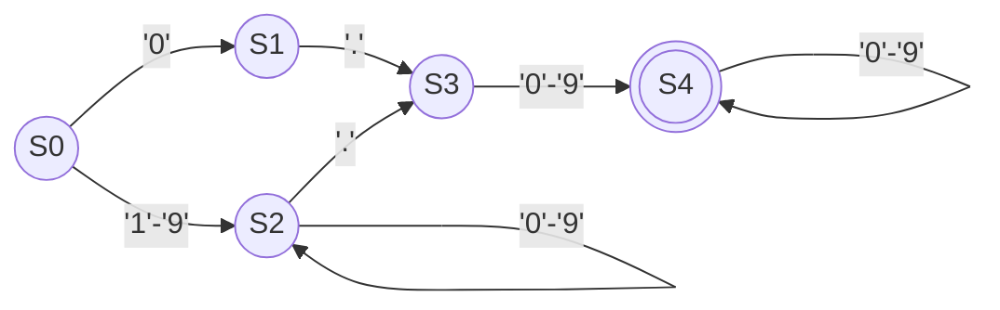

# Lab01 JFlex Group Project: Arithmetic Input Scanner

**Course:** Compilation I4 GIC  
**Academic Year:** 2026–2027  
**Lecturer:** OL Phearun  
**Topic 4:** Arithmetic Input Scanner  
**Project Repository / Archive:** `Lab01_GroupID_ArithmeticScanner`

---

## 👥 Group Members & Contribution

| Student ID | Full Name |
| :--- | :--- |
| `e20230078` | Khorn Victor |
| `e20230260` | Heng Meylorng |
| `e20230372` | Hour Samnang |

---

## 🎯 1. Project Purpose & Scope

The purpose of this project is to build a robust, complete lexical analyzer (scanner) using **JFlex** and **Java** that recognizes arithmetic expressions, numeric literals, operators, identifiers, and comments. In addition to a command-line interface (CLI) complying with the required project format, the application includes a modern, interactive **JavaFX Graphical User Interface (GUI)** featuring live tokenization, syntax diagnostics, an interactive DFA automaton tracer, and an integrated 16-case test runner.

### What the Scanner Recognizes (In Scope):
- **Identifiers:** Variable names following `[a-zA-Z_][a-zA-Z0-9_]*` (e.g., `total`, `qty`, `base_val`).
- **Numeric Literals:**
  - **Integers:** `0 | [1-9][0-9]*` (e.g., `0`, `42`, `1000`).
  - **Decimals:** `(0 | [1-9][0-9]*)\.[0-9]+` (e.g., `12.5`, `0.75`, `3.14159`).
- **Assignment Operators:** `=` (`ASSIGN`).
- **Arithmetic Operators:**
  - `+` (`OP_PLUS`), `-` (`OP_MINUS`), `*` (`OP_MUL`), `/` (`OP_DIV`), `%` (`OP_MOD`), `^` (`OP_POW`).
- **Comparison / Relational Operators:**
  - `>` (`OP_GT`), `>=` (`OP_GTE`), `<` (`OP_LT`), `<=` (`OP_LTE`), `==` (`OP_EQ`), `!=` (`OP_NEQ`).
- **Delimiters & Parentheses:**
  - `(` (`LPAREN`), `)` (`RPAREN`), `;` (`SEMICOLON`), `,` (`COMMA`).
- **Comments & Whitespace:**
  - Single-line comments (`// ...`) and multi-line comments (`/* ... */`) are cleanly skipped.
  - Spaces, tabs, and newlines are skipped while tracking 1-based line and column positions.
- **Error Handling:**
  - Unrecognized characters (e.g., `$`, `#`, `@`, `~`, `"`) are captured, reported with line and column numbers, and scanning **continues cleanly** until EOF without crashing.

### Left Outside Scope:
- Syntax parsing (checking if an expression forms a valid AST/parse tree).
- Semantic evaluation or calculating results of arithmetic expressions.
- Complex data types (strings, arrays, structs, matrices).

---

## 📋 2. Token Definitions Table

The scanner defines **20 useful token types** (well exceeding the minimum requirement of 6):

| Token Type | Category | Regular Expression Macro | Example Match | Description |
| :--- | :--- | :--- | :--- | :--- |
| `IDENTIFIER` | Identifier | `[a-zA-Z_][a-zA-Z0-9_]*` | `total`, `x1`, `qty` | Variable or function identifier |
| `INTEGER` | Literal | `0 \| [1-9][0-9]*` | `0`, `42`, `999` | Non-negative integer literal |
| `DECIMAL` | Literal | `{Integer}\.[0-9]+` | `12.5`, `0.75` | Fixed-point floating literal |
| `ASSIGN` | Assignment | `"="` | `=` | Assignment operator |
| `OP_PLUS` | Arithmetic | `"+"` | `+` | Addition |
| `OP_MINUS` | Arithmetic | `"-"` | `-` | Subtraction |
| `OP_MUL` | Arithmetic | `"*"` | `*` | Multiplication |
| `OP_DIV` | Arithmetic | `"/"` | `/` | Division |
| `OP_MOD` | Arithmetic | `"%"` | `%` | Modulo |
| `OP_POW` | Arithmetic | `"^"` | `^` | Power / Exponentiation |
| `OP_GT` | Comparison | `">"` | `>` | Greater than |
| `OP_GTE` | Comparison | `">="` | `>=` | Greater than or equal to |
| `OP_LT` | Comparison | `"<"` | `<` | Less than |
| `OP_LTE` | Comparison | `"<="` | `<=` | Less than or equal to |
| `OP_EQ` | Comparison | `"=="` | `==` | Equality test |
| `OP_NEQ` | Comparison | `"!="` | `!=` | Inequality test |
| `LPAREN` | Delimiter | `"("` | `(` | Left grouping parenthesis |
| `RPAREN` | Delimiter | `")"` | `)` | Right grouping parenthesis |
| `SEMICOLON` | Delimiter | `";"` | `;` | Statement terminator |
| `COMMA` | Delimiter | `","` | `,` | Argument separator |

---

## ⚖️ 3. Competing Rules & JFlex Resolution

### Case 1: Relational Operator `>=` vs `>`
- **Conflict:** When the scanner encounters `>=`:
  - Rule 1 matches `>` (length 1) followed by `=` (length 1).
  - Rule 2 matches `>=` (length 2).
- **Resolution:** JFlex applies the **Longest Match (Maximal Munch)** principle. Because `>=` matches 2 characters while `>` matches only 1 character, JFlex chooses Rule 2 and emits a single `OP_GTE` token instead of two distinct tokens.

### Case 2: Numeric Literals: Decimal `12.5` vs Integer `12`
- **Conflict:** When scanning `12.5`:
  - Rule `{Integer}` matches `12` (length 2).
  - Rule `{Decimal}` matches `12.5` (length 4).
- **Resolution:** By the **Longest Match** rule, JFlex prefers `{Decimal}` (4 characters) over `{Integer}` (2 characters), producing a single `DECIMAL` token.

### Case 3 (Bonus): Division Operator `/` vs Single-Line Comment `//`
- **Conflict:** When seeing `// notes`:
  - Rule `"/"` matches length 1.
  - Rule `"//" [^\r\n]*` matches the remainder of the line (length 9).
- **Resolution:** JFlex matches the comment macro and cleanly skips the whole comment without emitting erroneous division tokens.

---

## 🎨 4. Automaton (DFA) for `DECIMAL` Token

Pattern: `{Integer}\.[0-9]+` where `{Integer} = 0 | [1-9][0-9]*`

### State Transition Table:
| State | Input: `'0'` | Input: `'1'-'9'` | Input: `'.'` | Other Chars | Accepting? |
| :--- | :---: | :---: | :---: | :---: | :---: |
| **S0** (Start) | S1 | S2 | Error | Error | No |
| **S1** (Leading Zero) | Error | Error | S3 | Error | No |
| **S2** (Integer Digits) | S2 | S2 | S3 | Error | No |
| **S3** (Decimal Point) | S4 | S4 | Error | Error | No |
| **S4** (Accepting: DECIMAL) | S4 | S4 | Error | Error | **YES** |



---

## 🧪 5. Evidence from Tests (16 Recorded Tests)

All 16 tests are automated and pass with a 100% success rate:

| Test ID | Category | Test Input | Expected Output | Actual Result | Status |
| :--- | :--- | :--- | :--- | :--- | :---: |
| **N01** | Normal | `total = 12.5 + qty * 2;` | 8 tokens: ID, ASSIGN, DECIMAL, OP_PLUS, ID, OP_MUL, INT, SEMICOLON | 8 tokens matched cleanly | **PASS** |
| **N02** | Normal | `result = (base + offset) * (height / scale);` | 14 tokens with parentheses & operators | 14 tokens matched cleanly | **PASS** |
| **N03** | Normal | `y = 3 * x^2 + 7 % divisor;` | Power (`^`) and modulo (`%`) operators matched | 12 tokens matched cleanly | **PASS** |
| **N04** | Normal | `flag = (count >= 10) == (status != 0);` | Relational operators (`>=`, `==`, `!=`) recognized | 14 tokens matched cleanly | **PASS** |
| **N05** | Normal | `step = a + b - c * d / e; final_val = step + 42;` | 18 tokens across 2 statements | 18 tokens matched cleanly | **PASS** |
| **N06** | Normal | Mixed code with `//` and `/* ... */` comments | All comments skipped; 20 tokens produced | 20 tokens matched cleanly | **PASS** |
| **B01** | Boundary | `""` (Empty input) | 0 tokens, 0 errors, clean EOF | Handled cleanly (0 tokens) | **PASS** |
| **B02** | Boundary | `a>=b>c==d!=e<=f<g;` | Longest match disambiguation on adjacent symbols | `>=`,`>`,`==`,`!=`,`<=`,`<` | **PASS** |
| **B03** | Boundary | `a=12.50;b=12;c=0.99;d=0;` | Correct distinction between DECIMAL and INTEGER | Distinct literals verified | **PASS** |
| **B04** | Boundary | `val = 100 / 5; // inline comment` | Division operator emitted; comment skipped | 2 OP_DIV tokens found | **PASS** |
| **B05** | Boundary | `total = 999` (No newline/semicolon at EOF) | Clean EOF handling on literal | 3 tokens matched | **PASS** |
| **E01** | Invalid | `total = 50 $ 4;` | Lexical error reported for `$` at Line 1, Col 12 | Error caught; scan continued | **PASS** |
| **E02** | Invalid | `bad_var = #tag + @user;` | 2 lexical errors (`#` and `@`) reported at positions | Both errors caught cleanly | **PASS** |
| **E03** | Invalid | `val = 3.14.15;` | Decimal `3.14`, error on second `.`, integer `15` | Error on second `.` caught | **PASS** |
| **E04** | Invalid | `ratio = 10 ~ 2; name = "test";` | Errors on unsupported `~` and `"` symbols | Errors reported accurately | **PASS** |
| **BUG01**| Bug Fix | `x = 12. + 5;` | Incomplete decimal trailing dot rejected cleanly | `12` is INT, `.` is ERROR | **PASS** |

### 🐞 Bug Found and Correction:
- **Bug Identified:** If the Decimal rule were loosely defined as `{Integer}\.{Digit}*` (permitting 0 fractional digits), an input like `x = 12. + 5;` would treat `12.` as a decimal token.
- **Correction:** We enforced strict positive repetition for fractional digits: `{Decimal} = {Integer} \. {Digit}+`. Consequently, `12` is recognized as an `INTEGER`, the dangling `.` is flagged as an unexpected character, and scanning continues to parse `+` and `5`.

---

## 🛠️ 6. System Requirements & Build Instructions

### Software Versions:
- **Java Development Kit (JDK):** Version 17 or higher (tested on OpenJDK 17, 21, and 25).
- **JFlex:** Version 1.9.1 (bundled via `jflex-maven-plugin`).
- **JavaFX:** Version 21.0.2.
- **Apache Maven:** Version 3.8+ or 3.10+.

### Exact Generation, Compilation, and Execution Commands:

#### 1. Compile Scanner & Project:
```bash
mvn clean compile
```

#### 2. Run JavaFX Graphical User Interface (GUI):
```bash
mvn javafx:run
```
*Or using the standalone runnable JAR:*
```bash
java -jar target/arithmetic-scanner-1.0.0-jar-with-dependencies.jar --gui
```

#### 3. Run Command-Line Interface (CLI) on an Input File:
```bash
java -jar target/arithmetic-scanner-1.0.0-jar-with-dependencies.jar src/test/resources/tests/N01.txt
```
*Or with Maven:*
```bash
mvn exec:java -Dexec.args="src/test/resources/tests/N01.txt"
```

#### 4. Run the 16-Case Automated Test Suite:
```bash
java -jar target/arithmetic-scanner-1.0.0-jar-with-dependencies.jar --test
```
*Or with Maven:*
```bash
mvn exec:java -Dexec.args="--test"
```

#### 5. Build Standalone Runnable JAR for Submission:
```bash
mvn package -DskipTests
```
The resulting fat JAR is created at:
`target/arithmetic-scanner-1.0.0-jar-with-dependencies.jar`

---

## 💻 7. JavaFX GUI Features

1. **Integrated Code Editor:** Monospace editing with real-time character and line counting, quick snippets insert bar, and instant scan shortcuts (`F5` or `Ctrl+Enter`).
2. **Interactive Token Table:** TableView with index, token type, matched lexeme, line, column, category badges, and descriptions. Includes real-time keyword/category search and filtering.
3. **Diagnostics & Error Inspector:** Detailed listing of lexical errors with "Jump to Error" navigation to directly highlight the offending character in the editor.
4. **Interactive DFA Canvas:** Visual rendering of the `DECIMAL` finite automaton with live trace highlighting as digits are entered.
5. **Built-in Test Suite Panel:** 1-click execution of all 16 test cases with status indicators and expected vs. actual breakdown.
6. **Token Exporter:** Instant export of token streams to **CSV**, **JSON**, or formatted **Text**.

---

## ⚠️ 8. Known Limitations

- **Syntax Validation:** The scanner only performs lexical analysis; syntactically invalid expressions (such as `12 + * 5`) produce valid lexical tokens (`INTEGER`, `OP_PLUS`, `OP_MUL`, `INTEGER`) because grammar parsing is outside lexical scope.
- **Scientific E-notation:** Very large scientific floating point literals (e.g. `1.23e-4`) are outside this language subset and are treated as a decimal followed by identifier `e` and operators.
